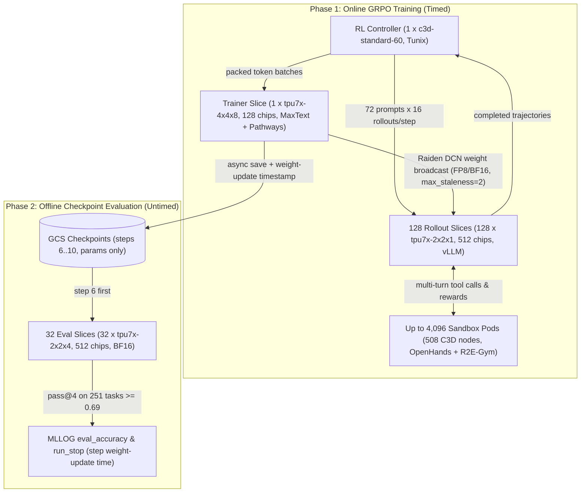

# Running Google Qwen3.5-397B-A17B GRPO (Tunix + MaxText + vLLM) MLPerf Training Benchmark on TPU7x

<!-- disableFinding(LINK_RELATIVE_G3DOC) -->

This file contains the instructions for running the Google Qwen3.5-397B-A17B
Group Relative Policy Optimization (GRPO) MLPerf Training benchmark
(`qwen35_397b_grpo`, closed division) on 640 Google Cloud TPU7x (Ironwood) chips
with Google Kubernetes Engine (GKE). The system pairs one `tpu7x-4x4x8` trainer
slice with 128 `tpu7x-2x2x1` rollout slices to train the policy on R2E-Gym
software-engineering tasks using an OpenHands `CodeActAgent` harness. The system
description is
[`systems/tpu7x-4x4x8-128x2x2x1.json`](../../../../systems/tpu7x-4x4x8-128x2x2x1.json),
and [`tpu7x-4x4x8-128x2x2x1_tunix.json`](tpu7x-4x4x8-128x2x2x1_tunix.json)
summarizes the versions and hyperparameters.

<!-- mdformat off(GitHub renders this file: keep single-line table rows) -->

Item                 | Details
-------------------- | -------
**Model & task**     | `Qwen/Qwen3.5-397B-A17B` trained with GRPO on R2E-Gym-Subset (easy split: 700 training, 251 validation tasks)
**Hardware (timed)** | 640 TPU7x chips (`1 x 4x4x8` trainer + `128 x 2x2x1` rollout) + shared GKE C3D CPU pools
**Batch & schedule** | Global batch size 1,152 (72 prompts x 16 rollouts per step), up to 10 steps
**Evaluation**       | Offline BF16 evaluation (not timed) on `32 x tpu7x-2x2x4` slices starting at step 6 (6,912 samples); target `pass@4 >= 0.69`
**Scored runs**      | All 3 runs reached target at step 6: **17.904 min**, **18.022 min**, **19.426 min** (MLPerf score: **18.022 min**)

<!-- mdformat on -->

## 1. Hardware Requirements

The system name `tpu7x-4x4x8-128x2x2x1` stands for the trainer slice (`4x4x8`,
128 chips) and the 128 rollout slices (`2x2x1`, 4 chips each, 512 chips). Each
training run has four online parts, followed by an offline checkpoint
evaluation:

<!-- mdformat off(GitHub renders this file: keep single-line table rows) -->

Part          | Runs on                                                                                                                    | Role
------------- | -------------------------------------------------------------------------------------------------------------------------- | ----
RL controller | 1 CPU node ([`c3d-standard-60`](https://docs.cloud.google.com/compute/docs/general-purpose-machines))                      | Runs the Tunix GRPO loop (logged as `[orchestrator]`).
Trainer       | 1 `tpu7x-4x4x8` slice, driven through Pathways from 1 CPU node (`c3d-standard-60`)                                         | Updates the policy with MaxText (FSDP=32, CP=4, EP=2, TP=1) and broadcasts updated weights to rollout slices over the data center network (DCN) via Raiden after each step.
Rollout       | 128 `tpu7x-2x2x1` slices                                                                                                   | Generates agent turns with vLLM on tpu-inference (DP=1, EP=8, TP=1 per slice).
Sandboxes     | Up to 4,096 sandbox pods at a time, one per agent episode, on the 508 sandbox nodes (at most 128 or 192 pods per node)     | Run the agent's tool calls and the R2E-Gym tests that produce the reward.

<!-- mdformat on -->

Sharding abbreviations above: fully sharded data parallelism (`FSDP`), context
parallelism (`CP`), expert parallelism (`EP`), tensor parallelism (`TP`), and
data parallelism (`DP`).



-   **TPU7x slices** (GKE dynamic slicing): one `4x4x8` trainer slice (128
    chips) and 128 `2x2x1` rollout slices (512 chips) for timed training; 32
    `2x2x4` slices (512 chips) for untimed offline evaluation.
-   **GKE CPU node pools** (`CREATE_NODEPOOLS=1 bash setup.sh`,
    [C3D machine series](https://docs.cloud.google.com/compute/docs/general-purpose-machines)):
    shared across concurrent runs on the cluster; see the table below.
-   **Storage**: a GCS bucket with about 10 TB for 3 runs: the converted
    checkpoint (0.64 TB), the dataset (0.5 GB) and the output of each run (3.2
    TB, almost all of it the 5 saved checkpoints of steps 6 to 10, 0.64 TB
    each).
-   **Checkpoint preparation** (section 3.3): a CPU machine with 1.5 TB of RAM
    for the CPU-only conversion of the 397B checkpoint and 1 TB of local disk
    for the Hugging Face checkpoint (0.81 TB).

<!-- mdformat off(GitHub renders this file: keep single-line table rows) -->

Node pool & machine type                        | Pool configuration                                                                                      | Used for                        | One run uses
----------------------------------------------- | ------------------------------------------------------------------------------------------------------- | ------------------------------- | ------------
`198 x c3d-standard-60-lssd`                    | `4 x 375 GB` local SSD, max 128 pods/node, Ubuntu, label & taint `workload=sandbox`                     | Sandboxes (508 nodes total)     | Up to 4,096 pods across both sandbox pools (per pod: agent `0.5 vCPU / 1 GiB` req, `2 vCPU / 4 GiB` limit; grading `0.05 vCPU / 128 MiB` req)
`310 x c3d-standard-90-lssd`                    | `8 x 375 GB` local SSD, max 192 pods/node, Ubuntu, label & taint `workload=sandbox`                     | Sandboxes (508 nodes total)     | (included in the 4,096-pod cap above)
`1 x c3d-standard-60-lssd`                      | `4 x 375 GB` local SSD, label & taint `workload=sandbox-controller`                                     | Sandbox controller              | Shared (one controller for the cluster)
`c3d-standard-60` (`CPU_NODEPOOL`)              | Container-Optimized OS, label `workload=cpu-user`                                                       | RL controller & Pathways heads  | 1 node for RL controller (220 GiB req) + 1 node for Pathways head and trainer client (eval runs 1 head pod/replica in this pool)

<!-- mdformat on -->

## 2. Software Requirements

-   **GKE cluster**: GKE `1.36+` (`1.36.4-gke.1247000` in the scored runs) with:
    -   **Controllers**: [JobSet](https://github.com/kubernetes-sigs/jobset)
        (`v0.12.0`), [Kueue](https://github.com/kubernetes-sigs/kueue)
        (`v0.18.2`), and
        [kubernetes-sigs/agent-sandbox](https://github.com/kubernetes-sigs/agent-sandbox)
        (`v1.0.4`).
    -   **Queue & priority**: Kueue LocalQueue `multislice-queue` and
        PriorityClass `medium` (override with `KUEUE_QUEUE` and
        `PRIORITY_CLASS`).
    -   **Service account**: `xpk-sa` (override with `SERVICE_ACCOUNT`), with
        access to the GCS bucket and permissions to manage pods and
        agent-sandbox resources (`SandboxTemplate`, `SandboxWarmPool`,
        `SandboxClaim`) in the namespace.
-   **Client tools**:
    [Google Cloud SDK (`gcloud`)](https://cloud.google.com/sdk), `kubectl`,
    [Docker](https://www.docker.com/), `git`,
    [`uv` / `uvx`](https://docs.astral.sh/uv/), and Python `3.12` (`datasets`,
    `jax`, `maxtext`).
-   **Container**: the image built from `../tunix/tunix/Dockerfile` (section
    3.1). `../tunix/SOURCE_VERSION.txt` lists the commits, image digests and
    versions of the scored runs, and `../tunix/requirements_frozen.txt` lists
    the exact Python packages of the container image.

## 3. Set up

Throughout, replace the angle-bracket placeholders with your own values.

### 3.1 Build the container

`setup.sh` clones `google/tunix` at the commit in `../tunix/SOURCE_VERSION.txt`
(into `../tunix/tunix` when not already populated), builds the `tpu_sync_jax`
wheel from `google/tpu-sync`, builds the container image from
`../tunix/tunix/Dockerfile`, pushes it to a registry and gets the cluster
credentials. With `CREATE_NODEPOOLS=1 ZONE=<zone>` it also creates the CPU node
pools. For a separate evaluation cluster, also set `EVAL_PROJECT`, `EVAL_REGION`
and `EVAL_CLUSTER`.

```bash
export PROJECT=<gcp-project> REGION=<region> CLUSTER=<tpu7x-gke-cluster> K8S_NAMESPACE=<namespace>
export TUNIX_IMAGE=<docker/registry:benchmark-tag>
bash setup.sh
```

### 3.2 Prepare the dataset

The benchmark dataset is R2E-Gym-Subset (easy split). `init_datasets.sh`
downloads and verifies it with the reference implementation's scripts (see the
script header), converts it to a Hugging Face `DatasetDict` and copies it to
GCS. The conversion keeps the order and content of the rows and stops with an
error if a row is missing or malformed or if a split does not have its 700
training or 251 validation rows.

`init_datasets.sh` also writes `sandbox_images.txt`, a list of the 700 training
task container images, which the RL controller can pull onto the sandbox nodes
before `init_start` (`PREPULL_SANDBOX_IMAGES`, section 4).

```bash
export MLCOMMONS_REF_DIR=<training-clone>/llm_post_training
export DATASET_GCS_DIR=gs://<bucket>/benchmark-r2e-gym-easy
export MAXTEXT_SCANNED_CKPT=gs://<bucket>/qwen35_397b/scanned_reshard_fsdp32_tp2/0/items
RUN_DATASET_DOWNLOAD=1 bash init_datasets.sh
```

At the end, the directory structure should look like:

```text
${DATASET_GCS_DIR}/
|-- dataset_dict.json
|-- sandbox_images.txt
|-- train/
|   |-- data-00000-of-00001.arrow
|   |-- dataset_info.json
|   `-- state.json
`-- validation/
    |-- data-00000-of-00001.arrow
    |-- dataset_info.json
    `-- state.json
```

### 3.3 Prepare the checkpoint

`init_datasets.sh` downloads the `Qwen/Qwen3.5-397B-A17B` checkpoint (bf16) with
the reference implementation's script and converts it on the CPU, without a TPU,
to a scanned MaxText checkpoint in GCS. Only the storage format and the sharding
change; the parameter values and their dtype (bf16) stay the same.

```bash
RUN_CKPT_CONVERSION=1 bash init_datasets.sh
```

At the end, the directory structure should look like:

```text
${MAXTEXT_SCANNED_CKPT%/0/items}/
`-- 0/
    |-- _CHECKPOINT_METADATA
    |-- commit_success.txt
    `-- items/
        |-- _METADATA
        |-- _sharding
        |-- array_metadatas/
        |-- commit_success.txt
        |-- decoder.decoder_norm.scale.value/
        |-- decoder.layers.layer_{0..3}.*/
        |-- decoder.logits_dense.kernel.value/
        `-- token_embedder.embedding.value/
```

The checkpoint of the scored runs is in the Flax NNX layout (`<name>.value`)
with `checkpoint_storage_use_ocdbt=false` (non-OCDBT Zarr layout), as listed
above.

`init_datasets.sh` writes the checkpoint sharded for 64 simulated CPU devices
(`ici_fsdp_parallelism=32`, `ici_tensor_parallelism=2`; hence `fsdp32_tp2` in
the path). The stored sharding does not have to match the training mesh: the
trainer restores the arrays onto its own 256-device mesh (FSDP=32, CP=4, EP=2,
TP=1).

## 4. Launch training

Each run has two phases: online GRPO training (Phase 1, via
`mlperf_gbs1024_submission.sh` with `BATCH_SIZE=72` for a global batch size of
1,152), followed by sequential offline evaluation of the saved checkpoints
(Phase 2, via `recipes/evals/mlperf_397b_v7x_eval.sh`). `run_and_time.sh` runs
both phases end-to-end; you can also invoke each phase directly as shown below.

`../tunix/SOURCE_VERSION.txt` lists the images of the scored runs, which used
the same container image and Pathways build for training and evaluation
(`EVAL_TUNIX_IMAGE`, `EVAL_PATHWAYS_SERVER_IMAGE` and
`EVAL_PATHWAYS_PROXY_IMAGE` default to the training images).

First, export the cluster, storage, dataset, checkpoint, and runtime image
settings (continuing from section 3):

```bash
export PROJECT=<gcp-project> REGION=<region> CLUSTER=<tpu7x-gke-cluster>
export BUCKET=gs://<bucket>
export PATHWAYS_SERVER_IMAGE=<pathways-server-image> PATHWAYS_PROXY_IMAGE=<pathways-proxy-image>
export OPENHANDS_SERVER_IMAGE=<openhands-agent-server-image>
export DATASET_PATH="${DATASET_GCS_DIR}" MAXTEXT_CKPT="${MAXTEXT_SCANNED_CKPT}"
export TPU_RESERVATION=<tpu7x-reservation>  # optional
```

### 4.1 Phase 1: Online GRPO training (`mlperf_gbs1024_submission.sh`)

From `../tunix/tunix` (or run `bash recipes/mlperf_gbs1024_submission.sh start`
from this directory):

```bash
export SEED="<seed>"
export JOB_PREFIX="<run-name>"
export K8S_NAMESPACE="<namespace>"
export WANDB_API_KEY="<wandb-api-key>"  # optional
export TUNIX_DEBUG_INFERENCE_LOGS=false
export DISABLE_TRAJECTORY_STORE=true
export TUNIX_IMAGE="<docker/registry:benchmark-tag>"
export CPU_NODEPOOL=cpu-np
export CPU_MEMORY=220Gi
export ROLLOUT_REPLICAS=128
export BATCH_SIZE=72
export INITIAL_DISPATCH_FIRST_STAGGER_S=75
export PREPULL_SANDBOX_IMAGES=false
bash tunix/experimental/examples/recipes/mlperf_gbs1024_submission.sh start
```

### 4.2 Phase 2: Offline checkpoint evaluation (`mlperf_397b_v7x_eval.sh`)

After the 10 training steps complete and tear down (`bash
recipes/mlperf_gbs1024_submission.sh stop`), evaluate the saved checkpoints
starting from step 6:

```bash
export RCP_LOGGING=true
export ROLLOUT_FP8=false
export TRAINER_FP8=false
export NUM_GENERATIONS=4
export ROLLOUT_ATTENTION_DP=true
export OPENHANDS_MULTI_TOOL_CALLS=true
export TUNIX_DEBUG_INFERENCE_LOGS=true
export USE_DEFAULT_SQL_STORE=false
export SEED=42
export ROLLOUT_REPLICAS=32
export BATCH_SIZE=128
export MAX_CONCURRENCY=512
export MAX_WARMPOOL_REPLICAS=16
export USER_CONTAINER_MEMORY=160G
export CHECKPOINT_MANIFEST_FILE="${BUCKET}/maxtext/${JOB_PREFIX}/mllog/eval_checkpoints.jsonl"
export EVAL_OUTPUT_DIR="${BUCKET}/maxtext/${JOB_PREFIX}/eval/eval_results/${JOB_PREFIX}"
export TARGET_ACCURACY=0.69
bash recipes/evals/mlperf_397b_v7x_eval.sh eval
```

### 4.3 End-to-end wrapper (`run_and_time.sh`)

`run_and_time.sh` runs Phase 1 (waiting for the orchestrator JobSet to complete
and tearing down the training JobSets) followed by Phase 2 in a single command:

```bash
export CPU_NODEPOOL=cpu-np
SEED=<seed> JOB_PREFIX=<run-name> K8S_NAMESPACE=<namespace> bash run_and_time.sh
```

Optional runtime overrides:

-   **Sandbox image pre-pull (`PREPULL_SANDBOX_IMAGES`)**: every sandbox runs
    the R2E-Gym container image of its task. With `true`, the RL controller
    pulls the 700 task images of `sandbox_images.txt` and the agent-server image
    onto every sandbox node before `init_start`; with `false` (the default, as
    in the scored runs), each node pulls a task image on demand.
-   **Registry mirror (`IMAGE_REWRITE_PREFIX`)**: rewrites each task image
    `<registry>/<user>/<name>:<tag>` to `${IMAGE_REWRITE_PREFIX}/<name>:<tag>`.
-   **Separate evaluation cluster (`EVAL_*`)**: set `EVAL_PROJECT`,
    `EVAL_REGION`, `EVAL_CLUSTER`, and `EVAL_K8S_NAMESPACE` to run Phase 2 on
    another TPU7x cluster.

The evaluation events and `run_stop` are appended to the run's MLLOG in
`${BUCKET}/maxtext/<run-name>/mllog/`. `run_and_time.sh` exits with `0` when a
checkpoint reaches the quality target, with `2` when none does (the run did not
converge), and with another non-zero code when training or an evaluation fails.
`postprocess_logs.sh` then builds the run's result file from its MLLOG and its
framework logs (see Result files in section 6).

## 5. Quality

### Quality metric

pass@4: the fraction of validation tasks solved by at least one of 4 attempts.

### Quality target

0.69

### Evaluation frequency

Every step starting at step 6 (6,912 training samples). From step 6 to the last
step, 10, training saves a checkpoint after every step, and evaluation stops at
the first checkpoint that reaches the target. The benchmark rules start the
offline evaluation at `global_batch_size * CEIL(2.5 + 3840 / global_batch_size)`
samples, which is step `CEIL(5.83) = 6` at a global batch size of 1,152.

### Evaluation thoroughness

All 251 validation tasks, 4 attempts each (1,004 rollouts), with temperature
0.1, top_p 0.95 and sampling seed 42.

## 6. Additional notes

### Scored runs

Global batch size 1,152 (72 prompts x 16 generations per step). All three runs
reached the quality target (`pass@4 >= 0.69`) at the first evaluated checkpoint,
step 6 (6,912 training samples). Dropping the fastest and slowest of the three
runs gives an MLPerf score of **18.022 min**.

<!-- mdformat off(GitHub renders this file: keep single-line table rows) -->

Result file    | Seed         | pass@4 at step 6 | Time to train
-------------- | ------------ | ---------------- | -------------
`result_0.txt` | `677013886`  | 0.7809 (196/251) | 17.904 min
`result_1.txt` | `1794911141` | 0.7649 (192/251) | 18.022 min
`result_2.txt` | `1520982257` | 0.7769 (195/251) | 19.426 min

<!-- mdformat on -->

### OpenHands harness

The harness is `examples/deepswe` in `google/tunix` @
`592380f2963d81cb710082c05f00b538afdb2aa2` (`../tunix/tunix`), based on the
OpenHands `CodeActAgent` at commit `0d766ad06b2be64a42e6f0175b9ebcc4a06599d9`
with the reference Qwen3.5 configuration (prompts, five tools `execute_bash`,
`think`, `finish`, `task_tracker`, and `str_replace_editor` with `security_risk`
optional in
[`examples/deepswe/template.py`](https://github.com/google/tunix/blob/592380f2963d81cb710082c05f00b538afdb2aa2/examples/deepswe/template.py),
30-turn limit, and termination behavior). In both training and offline
evaluation, every tool call of a model turn runs in order and counts as one of
the 30 turns, as in the reference (`OPENHANDS_MULTI_TOOL_CALLS=true`).
Deviations:

1.  Sandboxes are Kubernetes pods managed by `kubernetes-sigs/agent-sandbox`
    (`7fd162d9`) instead of Apptainer containers. An init container copies the
    OpenHands agent-server binary into each sandbox.
2.  Each `execute_bash` command runs in a new subshell, so the agent cannot
    return to a command after it times out (the reference keeps it running for
    further input). A wrapper keeps the working directory between commands and
    rebuilds the reference observation footer and 30,000-character truncation.
3.  `str_replace_editor` runs an in-sandbox port of the `openhands-aci` 0.3.2
    `OHEditor`.
4.  `/r2e_tests` and `/run_tests.sh` are hidden during rollout. For the reward,
    the agent's changes are applied in a clean container of the same task image,
    where the tests run.

### GRPO loss

The policy loss matches the reference GRPO loss and settings
([`NVIDIA-NeMo/RL@3fca04c9`](https://github.com/NVIDIA-NeMo/RL/blob/3fca04c9b313d313302923a5bb6b0c8dc0340ed6/qwen_35/configs/grpo_qwen35_397b_swe_openhands_async.yaml)):

<!-- mdformat off(GitHub renders this file: keep single-line table rows) -->

Setting                        | Submission value                                                                                                                               | Reference setting
------------------------------ | ---------------------------------------------------------------------------------------------------------------------------------------------- | -----------------
Loss aggregation               | Token-level mean (`LOSS_AGG_MODE=token-mean`)                                                                                                  | Token-level mean
Advantage baseline             | Leave-one-out group baseline, reward std-normalized (`ADVANTAGE_ESTIMATOR=grpo-loo`)                                                           | `use_leave_one_out_baseline: true`, `normalize_rewards: true`
Clipping                       | `EPSILON=0.2`, `EPSILON_HIGH=0.28`                                                                                                             | `[0.2, 0.28]`
KL penalty                     | None (`BETA=0.0`)                                                                                                                              | `0.0`
On-policy ratio                | Fixed to 1 (`USE_ROLLOUT_LOGPS=false`)                                                                                                         | `force_on_policy_ratio: true`
Truncated importance sampling  | Sequence-level mask (`seq-mask-tis` in `[0.999, 1.002]`)                                                                                       | `[0.999, 1.002]`
Dynamic sampling               | Off (zero-advantage groups kept)                                                                                                               | `use_dynamic_sampling: false`
Overlong / truncated rollouts  | `0.0` reward kept in 16-rollout baseline; tokens masked from loss numerator & denominator (`OVERLONG_LOSS_MASKING=true`, `OVERLONG_FILTER=false`) | `overlong_filtering: true`

<!-- mdformat on -->

### Precision

Training uses mixed precision (FP8 / BF16 / FP32):

-   **FP8 (`e4m3fn`)**: routed MoE experts in the rollout (weights and
    activations), their weights in the trainer's forward pass (BF16 weights
    rounded to FP8, with straight-through gradients), and their weight broadcast
    from trainer to rollout (`lowest_numerical_precision_in_linear = fp8`,
    `lowest_numerical_precision_in_comm = fp8`).
-   **BF16**: attention, KV cache, non-routed layers, trainer collectives
    (including the gradient all-reduce of parameters that are not sharded over
    the batch, such as norm scales, before their cast to FP32), and offline
    checkpoint evaluation (`lowest_numerical_precision_in_attn = bfloat16`).
-   **FP32**: router gate logits, output logits, gradient accumulation, and the
    AdamW first moment.

### Timing, MLLOG, and runtime notes

-   **Timing**: training runs 10 steps of 1,152 trajectories (72 prompts x 16)
    and records when each checkpoint's weights were updated. Evaluation runs
    offline, and `run_stop` uses the passing checkpoint's weight-update time, so
    the last checkpoint write and all evaluations are not timed.
-   **Start-up**: the scored runs did not pull the task images onto the sandbox
    nodes before `init_start` (`PREPULL_SANDBOX_IMAGES=false`). Between
    `init_start` and `run_start`, the RL controller registers the
    `SandboxTemplate` and initial `SandboxWarmPool` objects from the static
    image manifest (`sandbox_images.txt`, `wait=False`), and the trainer
    compiles on a synthetic micro-batch; dataset loading and rollout dispatch
    begin after `run_start`.
-   **Pre-seed run**: before the scored runs, a pre-seed run with `SEED=42` was
    run to pull sandbox images to disk and populate the sampler GCS JAX
    precompile cache and the trainer Pathways persistence compilation cache.
-   **MoE trainer**: dropless MoE routing (no token dropping).
-   **MLLOG**: `config_filename` is the model name; the configuration is
    `run_and_time.sh` and its recipes. `max_sequence_length` is 65,536
    (`VLLM_MAX_MODEL_LEN=65536`), split into an 8,192-token initial prompt
    budget and a 57,344-token multi-turn response budget. `micro_batch_size` and
    `gradient_accumulation_steps` are nominal: training packs sequences by
    tokens into micro-batches of up to 65,536 tokens per device.
-   **Seeds**: each run's seed is set with `SEED` and logged in the MLLOG `seed`
    event. `run_and_time.sh` draws one from `/dev/urandom` when `SEED` is unset;
    the scored runs set it explicitly.
-   **Compilation cache**: the rollout (sampler) and evaluation workers use a
    persistent GCS JAX precompile cache, and the trainer uses the Pathways
    persistence compilation cache.
-   **Reference implementation**:
    https://github.com/mlcommons/training/tree/master/llm_post_training

### Result files

`postprocess_logs.sh` builds each `result_*.txt` from the run's canonical MLLOG
and its framework logs:

-   Each framework line starts with its source: `[orchestrator]` (the RL
    controller); `[trainer]`, `[trainer-rm]` and `[trainer-proxy]` (the trainer
    and its Pathways resource manager and proxy); and `[eval]`, `[eval-rm]` and
    `[eval-proxy]` (the offline evaluation of the passing checkpoint). The 128
    rollout slices report episode and weight-sync telemetry through
    `[orchestrator]`.
-   The `:::MLLOG` lines are the run's canonical MLLOG lines, byte for byte.
    `submission_platform` is the value the runs logged,
    `tpu7x:4x4x8+tpu7x:2x2x1`: the trainer slice and the rollout slice type of
    the system `tpu7x-4x4x8-128x2x2x1`.
-   The RL controller runs on a CPU node, so at startup JAX reports that it
    cannot initialize a TPU (`TPU initialization failed`) and uses the CPU
    backend (`Control-plane JAX backend: cpu`).
-   `run_stop` is the last line but has an earlier `time_ms` than `eval_stop`:
    it carries the passing checkpoint's weight-update time (see Timing above).
-   In `result_0.txt`, the training phase ran under job prefix `at-1015b-s1` on
    the same container image (`sha256:d7e4c3b5...`) and its checkpoints were
    copied to `at-1015c-s1` for the offline evaluation (`ev-at-1015c-s1`).
